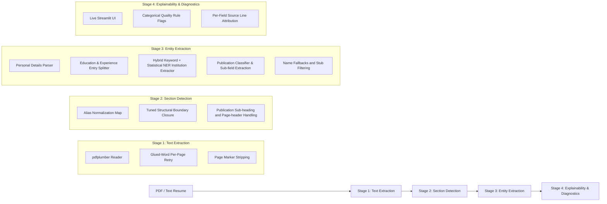

# NLU-Based Resume Information Extraction and Recruitment System

A rule-based (non-LLM) pipeline that turns academic CV PDFs into structured records: text extraction, section detection, entity parsing, and an explainability UI. Its education, experience and publication outputs are consumed by a separate shortlisting system (branch `shortlisting`).

## 📌 Project Status (branch `experiment/robust-extraction-pipeline`)

| Item | State |
| :--- | :--- |
| Corpus | 40 academic CV PDFs; 10 hand-labelled in `ground_truth/` (the **dev set**), 30 unlabelled |
| Pipeline | Stage 1 (text) → Stage 2 (sections) → Stage 3 (entities) all working; predictions for all 40 in `output/predictions/` |
| Headline metric | 25-field macro F1 **81.59%** on the dev set (80.16% at `6f10a86`). Tuned on these 10 resumes, so optimistic |
| Paper-level publications | 125 of 129 labelled papers found (96.9%); type correct for 112 of 125 (89.6%) |
| Shortlister inputs (dev set) | names 9/10; experience within 0.5 y on 8/10 and within 1 y on 9/10; publication totals exact on 5/10 (within ±10% on 6/10); PhD gate and degree level 10/10 (a weak test, 9 of the 10 are PhDs) |
| Generalisation | Label-free check on the other 30 resumes: the latest shortlisting fixes changed experience on 1 resume and no names. The gain is mostly specific to the labelled set, so it should not be claimed to generalise |
| UI | Streamlit app now calls the real pipeline functions, so it shows exactly what the batch run produces |
| Next | Fix education/skills/experience/projects errors found on a real CV through the UI; widen quality flags; blind audit of ~10 unlabelled resumes |

---

## 🏗️ Pipeline Architecture

The system processes PDF resumes through a modular 4-stage pipeline (Stages 1 to 3 are batch scripts in `src/`; Stage 4 is the UI):



1. **Stage 1: Text Extraction**: Extracts page-wise text from PDFs with `pdfplumber`, stripping page markers. If a page comes out with glued words (missing spaces, common in tightly kerned PDFs) it is re-extracted with a tighter `x_tolerance`; clean pages are left untouched.
2. **Stage 2: Section Detection**: Normalizes raw heading variants into canonical section keys (`education`, `experience`, `skills`, `publications`, etc.) using a JSON lookup map. Sub-headings inside a publications list ("Journal Articles") and repeated running page headers do not end the section. For every publications heading it also records the heading and its text (`publication_groups`) so Stage 3 can use the author's own headings.
3. **Stage 3: Entity Extraction**: Splits dense section blocks into discrete entry records and extracts granular sub-fields (job titles, dates, degrees, institutions, CGPA, graduation years) using deterministic NLU rules. Institution extraction employs a **hybrid Keyword + Statistical NER Fallback** architecture: keyword matching acts as the primary high-precision extractor, while a lightweight statistical NER model (`spacy en_core_web_sm`) extracts `ORG` entities when keywords are absent. **Publication typing** uses, in order: the author's own heading ("Communicated", "Working paper", "Book chapters"...), an explicit per-entry marker such as "(Communicated)", and finally text rules, defaulting to journal article. Activity lines (talks, workshops attended), count lines ("Total papers: 65") and metric lines are filtered out.
4. **Stage 4: Explainability & Diagnostic Layer**: A local web interface (Streamlit) that displays live stage-by-stage status, source line attribution, reason-for-missing mappings, and quality rule flags.


### Scripts and outputs

| Stage | Script | Writes |
| :--- | :--- | :--- |
| 1 | `src/extract_text_audited.py` | `data/real_resumes/extracted_text/` (not in repo) |
| 2 | `src/segment_resumes_into_sections.py` + `config/section_normalization_map.json` | `output/sections/` (not in repo) |
| 3 | `src/extract_structured_information.py` | `output/predictions/*.json` |
| Eval | `scratch/evaluate_pipeline.py` | `output/evaluation/*.csv` |
| UI | `src/explainability/streamlit_app.py` | none (display only) |

The UI shares `build_prediction(data)` with Stage 3, so batch and UI output are identical.

---

---

## 📊 Final 25-Field Pipeline Accuracy Metrics

The pipeline is scored against the 10 hand-labelled academic resumes in `ground_truth/` over 25 fields, using `scratch/evaluate_pipeline.py` (numbers below are regenerated from `output/evaluation/section_metrics.csv` by `scratch/update_readme.py`). The remaining resumes have no labels and are only checked with label-free audits.

**How to read these numbers**

- They are **development-set numbers**: the rules were tuned while looking at these same resumes, so they are optimistic for unseen CVs.
- Experience dates are compared **ignoring whitespace and dash style** (`2015 - Present` equals `2015-Present`). This is a measurement choice made in the evaluator, not an extraction improvement.
- The publication fields are scored as a **bag of words per publication type**, not paper by paper, so they cannot see missing, truncated or extra papers. `scratch/pub_paper_level.py` gives a title-matched paper-level view.

| FIELD NAME | PRECISION | RECALL | F1 SCORE |
| :--- | :---: | :---: | :---: |
| `certifications` | 52.41% | 57.61% | **53.19%** |
| `education_cgpa` | 83.33% | 71.00% | **75.59%** |
| `education_degree` | 90.83% | 83.90% | **86.36%** |
| `education_graduation_year` | 98.33% | 87.48% | **91.12%** |
| `education_institution` | 67.40% | 74.19% | **70.32%** |
| `experience_dates` | 77.21% | 86.67% | **80.84%** |
| `experience_institution` | 70.36% | 77.08% | **72.78%** |
| `experience_title` | 94.29% | 97.50% | **95.46%** |
| `personal_email` | 100.00% | 100.00% | **100.00%** |
| `personal_name` | 90.00% | 90.00% | **90.00%** |
| `personal_phone` | 90.00% | 85.00% | **86.67%** |
| `projects` | 66.29% | 65.95% | **65.83%** |
| `publications_book_chapters` | 83.01% | 81.05% | **81.38%** |
| `publications_books` | 100.00% | 100.00% | **100.00%** |
| `publications_communications` | 98.57% | 95.71% | **96.92%** |
| `publications_conference_papers` | 54.39% | 60.89% | **56.45%** |
| `publications_conference_proceedings` | 94.60% | 98.59% | **96.28%** |
| `publications_journal_articles` | 78.19% | 89.98% | **82.49%** |
| `publications_preprints` | 96.74% | 92.58% | **94.43%** |
| `publications_technical_reports` | 96.86% | 97.78% | **97.29%** |
| `references` | 66.33% | 58.85% | **62.21%** |
| `research_interests` | 77.25% | 85.88% | **78.75%** |
| `responsibilities` | 84.90% | 86.29% | **85.16%** |
| `skills` | 81.63% | 85.79% | **81.89%** |
| `summary` | 57.22% | 60.00% | **58.39%** |
| **AVERAGE MACRO FIELD F1 (25 FIELDS)** | | | **81.59%** |

---

## 🔍 Known Pipeline Limitations

1. **Hybrid Institution Extraction Ceiling**: Pure keyword matching (`University`, `Institute`, `College`, `School`, `IIT`, `NIT`) has a proven ceiling on non-standard organization names (such as small company names or regional school boards). Rather than expanding keyword lists indefinitely, a lightweight statistical NER model (`spacy en_core_web_sm`) is integrated as a fallback to extract `ORG` entities when keywords are absent.
2. **Narrative / Prose-Style Skills Sections**: When a candidate writes their skills section as narrative paragraphs rather than itemized bullet points, list-splitting cannot reliably separate individual skills. Rather than returning false bullet points, the pipeline raises an explicit quality flag (`possible_narrative_skills_not_itemized`).
3. **Complex Multi-Column Headers**: Resumes with dense multi-column headers merged by PDF text extractors can occasionally obscure candidate name boundaries. The pipeline uses multi-space splitting and title-word filtering to mitigate this.
4. **Small labelled set**: only 10 resumes are hand-labelled, so every accuracy figure is a development-set figure with wide uncertainty; it is not a held-out estimate.
5. **Wrapped citations**: a citation whose line wraps in the PDF can still be split into two entries, which inflates publication counts on some long lists.
6. **Publication categories follow the author's headings**: where an author uses one generic "Publications" heading, journal versus conference is decided by text rules and is less reliable.


## 🚧 Open Issues

**Extraction (dev set; individual resumes are deliberately not named)**

- `personal_name`: one resume still returns an empty name (the name sits inside the education block and the email appears on a later line).
- `experience`: one resume is over-counted (7.8 y vs 2.4 y labelled; a labelling-scope question about a teaching-assistant role) and one has a phantom entry (1.0 y vs 0) because a course line is given an "institution" and survives the stub filter.
- `publications`: one resume predicts 15 conference papers vs 4 labelled (labels probably incomplete); one has 3 conference papers typed as journal; one has 2 missing and 2 merged entries; one finds 9 of 12; wrapped continuation lines still become separate entries in some CVs.
- Book chapters on one long publication list: 16 predicted vs 4 stated by the author.
- Section routing misses on three education blocks, and one leaked entry after a "Conferences and Workshops attended" heading, are not yet re-verified.

**Found by running a real CV through the UI (causes not yet diagnosed)**

- Education entries look shifted by one (degree and institution mismatched; "College" taken as an institution).
- Experience institution can capture bullet text; skills can come back empty; project titles stick to the previous bullet with `(cid:N)` / `§` icon glyphs.
- Quality flags are too narrow: they miss missing degree, generic-word institutions, empty skills and institutions containing verbs.
- UI: a source line starting with `#` renders as a Markdown heading.

**Evaluation**

- Experience dates are compared ignoring whitespace and dash style, and publication fields are scored as a bag of words, so some real errors are invisible to the macro F1.
- All labelled numbers are dev-set numbers; a blind audit of unlabelled resumes is still to be done.
- `data/entity_annotations/external/*` and its manifest are to be relabelled or removed.

---

## 🧾 Recent Changes

| Commit | Change |
| :--- | :--- |
| `e667d22` | Stage 1 per-page glued-word retry (affected files 11/40 → 2); Stage 2 keeps publication sub-headings, drops repeated page headers; `publication_groups` committed for reproducibility |
| `a20e416` | Stage 3 publication cleanup (count lines, label prefixes, bare sub-headings, glued "Chaptersin Books", block ends at explicit headings); README regenerated from measured metrics |
| `afeac56` | "Work/Employment History" headings; name-line contact-tail cut; name-from-email fallback; title-less/institution-less experience stubs dropped |
| `9cb443a` | UI calls the real pipeline functions; shared `build_prediction`; fixed `ModuleNotFoundError: src` |

Macro F1 trail (dev set): 80.16 → 80.43 (publication cleanup) → 81.59 (shortlisting fixes: experience_title 85.45 → 95.46, experience_dates 72.27 → 80.84, personal_name 80 → 90).

---
---

## 🛠️ How to Run & Local Web UI

### 0. Setup

```bash
python -m pip install -r requirements.txt
python -m spacy download en_core_web_sm
```

### 1. Launch the Live Streamlit Explainability App locally
Run from the project root to upload resumes and view live stage-by-stage diagnostics:

```bash
streamlit run src/explainability/streamlit_app.py
```

### 1b. Run the batch pipeline

```bash
python src/extract_text_audited.py
python src/segment_resumes_into_sections.py
python src/extract_structured_information.py
```

### 2. Run Automated Regression & Evaluation Scripts

- **Run Strict 25-Field Evaluation**:
  ```bash
  python scratch/evaluate_pipeline.py
  ```

- **Run Personal Details Regression Test**:
  ```bash
  python scratch/test_personal_fields_regression.py
  ```

- **Run Coverage & Routing Accuracy Evaluator**:
  ```bash
  python scratch/evaluate_coverage_routing.py
  ```

- **Compare two evaluation runs / see which fields changed**:
  ```bash
  python scratch/compare_runs.py before.txt after.txt
  python scratch/bucket_diff.py
  python scratch/unlabelled_delta.py
  ```

- **Paper-level publication check and shortlister-input check**:
  ```bash
  python scratch/pub_paper_level.py
  python scratch/shortlist_inputs_check.py
  ```

- **Regenerate the metrics table in this README**:
  ```bash
  python scratch/update_readme.py
  ```

> `output/sections/`, `data/real_resumes/extracted_text/` and the source PDFs are not tracked in the repo. Set `git config gc.auto 0` if OneDrive locks the `.git` folder.