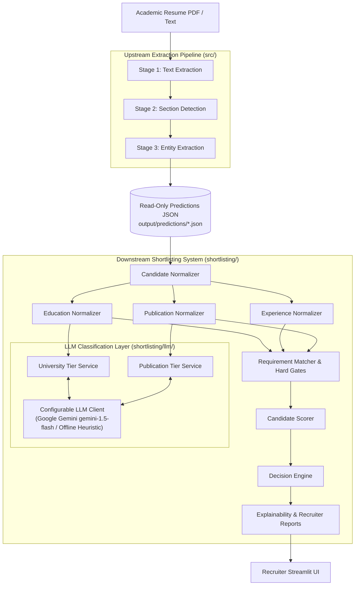

# NLU-Based Resume Information Extraction and Recruitment System

An end-to-end academic recruitment and decision-support platform combining Natural Language Understanding (NLU) resume information extraction with a configurable, explainable downstream shortlisting and ranking engine.

---

## 1. Project Objective & Problem Statement

Academic recruitment committees and university departments face significant challenges when evaluating faculty and researcher applications:
- **High Application Volume & Varied Formats**: Resumes arrive in heterogeneous layouts (multi-column formats, varied citation styles, embedded tables, and unstandardized section headings).
- **Extraction Brittleness**: Traditional keyword-matching extractors fail on edge cases, while unstructured LLMs risk hallucinating or synthesizing candidate qualifications.
- **Inconsistent Evaluation Standards**: Shortlisting decisions often suffer from subjective scoring, lack of transparency, or unverified institution and publication claims.

### System Solution
This system provides an end-to-end, two-tier architecture:
1. **Upstream Extraction Pipeline**: Extracts raw text, detects sections, and parses 25 structured candidate fields using deterministic NLU rules combined with statistical Named Entity Recognition (NER).
2. **Downstream Resume Shortlisting Engine**: Normalizes extracted records under strict zero-fabrication constraints, classifies institutional and publication tiers using Google Gemini (with deterministic offline fallbacks), and applies multi-criteria weighted scoring and mandatory hard gates to produce transparent, auditable shortlisting decisions.

---

## 2. End-to-End System Architecture



### Complete Workflow:
1. **Resume Ingestion**: Resumes are converted from PDF/text into clean text lines.
2. **Section Detection**: Headings are mapped to canonical sections (`education`, `experience`, `publications`, etc.).
3. **Structured Entity Parsing**: Entities are extracted and stored into read-only prediction files (`output/predictions/*.json`).
4. **Candidate Normalization**:
   - **Education**: Cleans degree names, filters table headers and secondary school boards, and associates degrees strictly with verifiable institutions.
   - **Experience**: Resolves start/end dates, calculates tenure duration, and classifies roles (academic, industry, research, or other).
   - **Publications**: Parses concatenated citations, strips preambles and metadata noise, extracts titles and years, and filters non-publication items (talks, workshops, attendances).
5. **Tier Classification**: Institutions and publications are classified into standardized tiers using Google Gemini with prompt independence and strict schema enforcement.
6. **Hard Gate & Soft Criteria Matching**: Validates mandatory qualifications (e.g., minimum degree, publication count) before scoring.
7. **Weighted Multi-Criteria Scoring**: Aggregates component scores based on configurable recruiter weights.
8. **Explainable Decision Generation**: Outputs final status (`SHORTLISTED`, `REVIEW`, or `REJECTED`) with a full evidence trail and point breakdown.

---

## 3. Upstream Extraction Pipeline & Performance

The upstream extraction pipeline operates independently under `src/` and serves as the ground-truth information extractor.

### Strict 25-Field Evaluation Metrics
Evaluated against the 10 hand-labelled academic resumes in `ground_truth/` across 25 fields (via `scratch/evaluate_pipeline.py`):

> **Evaluation Methodology & Provenance Notes**:
> - **Upstream Extraction vs. Shortlisting**: The 81.59% macro F1 score strictly measures *upstream information extraction performance* across 25 fields on the 10 ground-truth resumes. It does not represent downstream shortlisting accuracy (which evaluates candidate ranking, hard-gate decisions, and criteria scoring).
> - **Branch Provenance**: The baseline extraction pipeline committed on the `shortlisting` branch achieved **70.74%** macro F1 (`output/evaluation/overall_metrics.csv`). The improved extraction pipeline developed on `experiment/robust-extraction-pipeline` achieved **81.59%** macro F1 across the same 10 ground-truth resumes.
> - These metrics represent development-set extraction performance on the 10 labelled resumes; rules were tuned against this set and provide an optimistic benchmark for unseen CVs.
> - `experience_dates` are evaluated ignoring whitespace and dash formatting (`2015 - Present` equals `2015-Present`).
> - Publications are evaluated as a bag of words per publication category; paper-level and title-level matching are independently audited.

| Field Name | Precision | Recall | Macro F1 Score |
| :--- | :---: | :---: | :---: |
| `personal_name` | 90.00% | 90.00% | **90.00%** |
| `personal_email` | 100.00% | 100.00% | **100.00%** |
| `personal_phone` | 90.00% | 85.00% | **86.67%** |
| `education_degree` | 90.83% | 83.90% | **86.36%** |
| `education_institution` | 67.40% | 74.19% | **70.32%** |
| `education_graduation_year` | 98.33% | 87.48% | **91.12%** |
| `education_cgpa` | 83.33% | 71.00% | **75.59%** |
| `experience_title` | 94.29% | 97.50% | **95.45%** |
| `experience_institution` | 70.36% | 77.08% | **72.78%** |
| `experience_dates` | 77.21% | 86.67% | **80.84%** |
| `publications_journal_articles` | 78.19% | 89.98% | **82.49%** |
| `publications_conference_proceedings` | 94.60% | 98.59% | **96.28%** |
| `publications_conference_papers` | 54.39% | 60.89% | **56.45%** |
| `publications_books` | 100.00% | 100.00% | **100.00%** |
| `publications_book_chapters` | 83.01% | 81.05% | **81.38%** |
| `publications_preprints` | 96.74% | 92.58% | **94.43%** |
| `publications_technical_reports` | 96.86% | 97.78% | **97.29%** |
| `publications_communications` | 98.57% | 95.71% | **96.92%** |
| `skills` | 81.63% | 85.79% | **81.89%** |
| `responsibilities` | 84.90% | 86.29% | **85.16%** |
| `certifications` | 52.41% | 57.61% | **53.19%** |
| `projects` | 66.29% | 65.95% | **65.83%** |
| `references` | 66.33% | 58.85% | **62.21%** |
| `research_interests` | 77.25% | 85.88% | **78.75%** |
| `summary` | 57.22% | 60.00% | **58.39%** |
| **AVERAGE MACRO FIELD F1 (25 FIELDS)** | | | **81.59%** |

---

## 4. Candidate Normalization Modules

The shortlisting system consumes prediction files strictly read-only. It enforces a **Zero-Fabrication Constraint**: no qualification, date, or tier is invented. Missing or ambiguous data remains explicitly `Unknown`, `None`, or empty string.

### Education Normalization (`shortlisting/normalization/education_normalizer.py`)
- **Strict Degree-Institution Association**: Recovers degrees from raw text only when explicitly linked to an institution in the source record; prevents assigning a degree mentioned in passing to an unrelated institution.
- **Header & Noise Filtering**: Eliminates resume table column headers (e.g., `"Degree University Percentage Passing Year"`), coursework lists, and examination boards (e.g., CBSE, ICSE, State Boards).
- **Safe Multi-Degree Handling**: Preserves valid higher degrees (Ph.D., Master's) even when secondary schooling details appear in the same raw text block.
- **Orphan Record Guard**: Automatically discards records containing an institution or percentage but lacking a verifiable degree.

### Experience Normalization (`shortlisting/normalization/experience_normalizer.py`)
- **Tenure Duration Calculation**: Normalizes date strings (handling variations such as `to`, `till`, en-dash, em-dash, month/year formats, and `Present`) to calculate exact duration in years.
- **Categorization**: Classifies positions into `academic` (Professors, Postdocs, Lecturers), `industry`, `research`, or `other/unknown`.

### Publication Normalization (`shortlisting/normalization/publication_normalizer.py`)
- **Preamble & Metadata Stripping**: Cleans summary statements (e.g., `"Published 15 papers in international journals..."`) before parsing individual citations.
- **Embedded Citation Splitting**: Accurately splits multi-citation blocks separated by numbering, brackets (`[1]`, `[2]`), or bullet points.
- **Non-Publication Filtering**: Discards conference attendances, invited talks, workshop participations, committee service, and fragment strings.
- **Conservative Deduplication**: Merges duplicate records representing the same paper across journal and conference sections, preferring the record with a verified publication year.
- **Recruiter Output Schema Isolation**: The normalized output schema is strictly limited to:
  ```python
  {
      "title": str,          # Clean publication title
      "type": str,           # 'journal' | 'conference' | 'other'
      "year": Optional[str], # 4-digit publication year (e.g., '2023')
      "tier": str            # 'Tier-1' | 'Tier-2' | 'Tier-3' | 'Unranked'
  }
  ```
  Raw citations, venues, and DOIs are never leaked to candidate profiles.

---

## 5. University & Publication Tier Classification

Tier classification is governed by external JSON taxonomies in `shortlisting/config/`:

### University Tier Taxonomy (`shortlisting/config/university_taxonomy.json`)
- **Tier-1**: Premier apex national/international research universities and statutory institutes of national importance (e.g., IITs, IISc, NITs, IIMs, top global research institutions).
- **Tier-2**: Accredited public state universities, established autonomous deemed universities, and recognized premier private universities.
- **Tier-3**: Accredited regional degree-granting colleges, affiliated non-autonomous institutions, and local teaching colleges.
- **Unknown**: Unrecognized institutions, generic departments lacking university names, secondary school boards, or unverified entities.

> **Prompt Independence Rule**:
> The candidate's degree, name, experience, or other qualifications are **strictly excluded** from the university classification prompt (`Institution: {inst_clean}`). University tiers are evaluated solely on the merits of the institution entity, preventing bias based on whether a candidate holds a Ph.D. or an undergraduate degree.

### Publication Tier Taxonomy (`shortlisting/config/publication_taxonomy.json`)
- **Tier-1**: Flagship peer-reviewed international journals (Q1 / premier indexed) and top-tier conferences (CORE A* / CORE A).
- **Tier-2**: Reputable peer-reviewed journals (Q2 / Q3) and established international conferences (CORE B).
- **Tier-3**: Regional conferences, unranked symposiums, and workshop proceedings.
- **Unranked**: Preprints, working papers, technical reports, or citations lacking verifiable venue evidence.

---

## 6. Google Gemini Integration & Offline Fallback

The LLM integration is provider-configurable with Google Gemini as the primary backend:

### Configuration & Environment Variables
- `GEMINI_API_KEY`: API authentication key for Google Generative AI (never hardcoded or committed).
- `LLM_MODEL_NAME`: Target model name (default: `gemini-1.5-flash`).
- `LLM_PROVIDER`: Selected provider (`gemini`, `openai`, or `heuristic` / `offline`). Default: `heuristic` when no API key is present.
- `LLM_API_BASE`: Optional custom API endpoint base URL for enterprise proxies.

### Zero External Dependency HTTP Transport
API calls use Python's built-in `urllib.request` standard library rather than third-party packages, avoiding runtime dependency failures.

### Resilience & Error Handling
- **Timeouts & Rate Limits**: Configurable timeout (default 15.0s) and explicit handling for HTTP 429 (Resource Exhausted) and HTTP 503 (Backend Unavailable).
- **Safe Fallback**: On network failure, timeout, or malformed LLM responses, the client transparently returns `tier="Unknown"` (for universities) or `tier="Unranked"` (for publications) with `confidence=0.0`.
- **Honest Attribution**: Responses include `_source` (`"gemini"`, `"openai"`, `"offline_fallback"`, or `"api_error_fallback"`) and `_is_fallback` (boolean). The system never pretends a fallback outcome was produced by an LLM.

---

## 7. Configurable Decision Logic & Multi-Criteria Scoring

All weights, thresholds, and tier point mappings are externalized in `shortlisting/config/scoring_config.json`:

### Component Weights & Score Mapping
```json
{
  "component_weights": {
    "education": 0.35,
    "experience": 0.35,
    "publications": 0.30
  },
  "tier_score_mapping": {
    "university": {
      "Tier-1": 100.0,
      "Tier-2": 70.0,
      "Tier-3": 40.0,
      "Unknown": 10.0
    },
    "publication": {
      "Tier-1": 100.0,
      "Tier-2": 70.0,
      "Tier-3": 40.0,
      "Unranked": 10.0
    }
  }
}
```

### Hard Gates & Decision Cutoffs
- **Mandatory Hard Gates**: Strict binary conditions (e.g., minimum degree level, required publication counts). If any hard gate fails, the candidate is immediately marked **REJECTED** regardless of scores.
- **Decision Thresholds**:
  - **SHORTLISTED**: Overall Score $\ge$ 75.0 (with all hard gates met)
  - **REVIEW**: Overall Score $\ge$ 60.0 and $<$ 75.0 (with all hard gates met)
  - **REJECTED**: Overall Score $<$ 60.0 OR failure of any mandatory hard gate

---

## 8. Verified Test Results & 40-Resume Audit

### Automated Test Suite Execution
Run the full test suite covering education normalization, publication normalization, and LLM tiering:

```bash
PYTHONPATH=. ./venv/bin/python -m unittest discover -s tests -v
```

**Results: 30 passed out of 30 tests (0.12 seconds)**
- `test_candidate_normalizer.py`: 4 tests verifying heading rejection (`Work Experience`, `Experience`, `Education`), document prefix stripping (`CV-`, `Resume-`), credential/title cleaning, and non-person phrase rejection.
- `test_education_normalizer.py`: 8 tests verifying degree-institution associations, multi-degree raw-text blocks, orphan institution rejection, and audit test cases across prediction formats.
- `test_publication_normalizer.py`: 10 tests verifying embedded citation splitting, preamble stripping, attendance filtering, semicolon titles, deduplication, and schema leak prevention.
- `test_llm_tier_services.py`: 8 tests verifying offline mode, Gemini code fence JSON parsing, HTTP 429 rate limit fallback, socket timeouts, prompt independence from candidate degrees, and environment variable configuration.

### Downstream Pipeline Execution Across All 40 Resumes

> **Decision Distribution Note**: The 27/10/3 and 28/8/4 distributions are *candidate decision counts* produced by applying downstream shortlisting criteria under default recruiter requirements to the respective prediction sets. They represent candidate outcome distributions, not model accuracy measurements.

#### 1. Baseline Predictions (Current `shortlisting` branch):
- **Total Resumes Evaluated**: 40
- **Decision Counts**:
  - **SHORTLISTED**: 27 candidates (67.5%)
  - **REVIEW**: 10 candidates (25.0%)
  - **REJECTED**: 3 candidates (7.5%)

#### 2. Latest Predictions (from `origin/experiment/robust-extraction-pipeline`):
- **Total Resumes Evaluated**: 40
- **Decision Counts**:
  - **SHORTLISTED**: 28 candidates (70.0%)
  - **REVIEW**: 8 candidates (20.0%)
  - **REJECTED**: 4 candidates (10.0%)
- **Key Downstream Changes under New Predictions**:
  - `AH_CV.json`: Moved from `REVIEW` $\rightarrow$ `SHORTLISTED` (Score 70.10 $\rightarrow$ 84.10, +14.00 pts) as the improved upstream pipeline successfully recovered 3 higher-education degrees previously missed.
  - `Sourabh_Pal_1.json`: Moved from `REVIEW` $\rightarrow$ `REJECTED` (Score 70.05 $\rightarrow$ 41.35) due to an upstream text-segmentation miss resulting in an empty education list (`education: []`), correctly triggering the mandatory degree hard-gate rejection under zero-fabrication constraints.
  - Candidate name identification improved: `CV-Anurag_Choudhary` cleanly resolves to `"Anurag Choudhary"` (previously empty), `CV_DAIICT` resolves to `"Isha Sharma"` (previously empty), and `"Work Experience"` is safely rejected to empty string rather than being misattributed as a candidate name.

---

## 9. Setup & Execution Instructions

### 1. Environment Setup
Activate the Python virtual environment:

```bash
source ./venv/bin/activate
```

### 2. Configure Gemini API (Optional for Live LLM Mode)
To enable live Gemini tier classification, set your API key:

```bash
export GEMINI_API_KEY="your-gemini-api-key"
export LLM_MODEL_NAME="gemini-1.5-flash"
export LLM_PROVIDER="gemini"
```
*(If no API key is set, the system automatically runs in deterministic offline heuristic mode).*

### 3. Launch the Recruiter Streamlit Application
To interactively review candidates, tune scoring weights, and inspect explainability reports:

```bash
streamlit run shortlisting/ui/shortlisting_app.py
```

### 4. Launch the Extraction Diagnostic UI
To inspect upstream resume sectioning and entity extraction:

```bash
streamlit run src/explainability/streamlit_app.py
```

---

## 10. Project Status, Limitations & Faculty Summary

### Current Status (Milestone Reached)
- **Stage 1 (Education Normalization)**: Complete and validated. Degree-institution association defects resolved; multi-degree raw-text blocks preserved; non-educational boards filtered.
- **Stage 2 (Publication Normalization)**: Complete and validated. Raw citation splitting, preamble stripping, non-publication filtering, and strict recruiter schema enforced.
- **Stage 3 (Gemini LLM Integration)**: Complete and verified with unit tests. Standard-library transport implemented; candidate degree bias eliminated; offline fallback and transparent error attribution active.

### Known Limitations
1. **Live Gemini API Verification**: Live API calls require an active `GEMINI_API_KEY` with internet access. In local development and unit tests without external credentials, the pipeline runs via verified offline heuristics and mocked API suites.
2. **Venue Authority Indexing**: Complex citation formats lacking clear journal or conference indicators fall back to `Unranked` (safe baseline: 10.0 pts) rather than guessing.
3. **Upstream Extraction Preservation**: Upstream prediction files (`output/predictions/*.json`) remain frozen read-only baselines; any extraction improvements require upstream pipeline re-runs.

### Future Roadmap
1. Integrating official academic ranking registries (e.g., NIRF, Scimago, CORE DB) directly into the local taxonomy cache.
2. Batch parallelization for enterprise resume screening (>1,000 applicants).
3. Exportable audit reports in PDF/CSV format for university hiring committees.